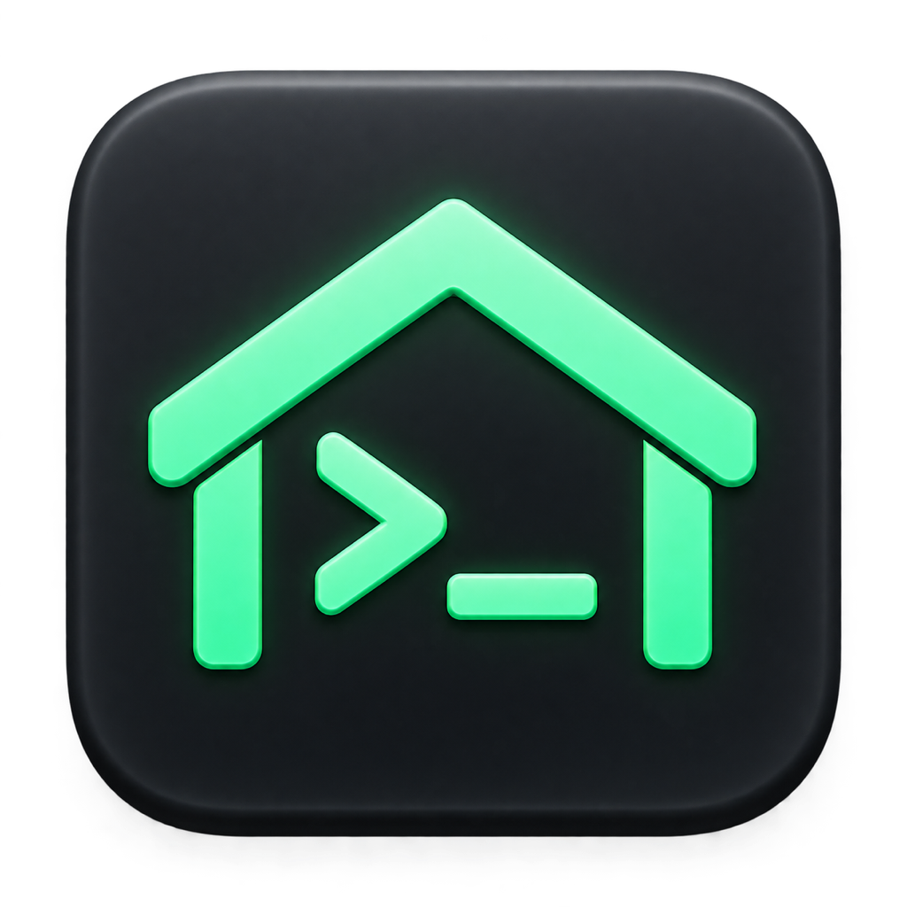

<p align="center">
  
</p>

<h1 align="center">Shellter</h1>

<p align="center">
  <a href="https://github.com/n-kitx/shellter/actions/workflows/ci.yml"></a>
  <a href="LICENSE"></a>
</p>

<p align="center">
  A fast, native terminal emulator for macOS, drawn on the GPU with Metal.
</p>

<p align="center">
  <a href="https://n-kitx.github.io/shellter/">Website</a> ·
  <a href="https://github.com/n-kitx/shellter/releases/latest/download/Shellter.dmg">Download</a> ·
  <a href="docs/ARCHITECTURE.md">How it works</a>
</p>

---

Shellter is a macOS terminal written in Go and Objective-C. It is built for
speed first: output is parsed in runs, the PTY is read on its own thread, and
every frame is drawn in six instanced Metal draw calls.

## Features

- **Fast.** About 170 MB/s of output through a real shell, at 120 fps, with
  the main thread at roughly 10% of a core while output streams.
- **Tabs and splits.** Split any pane right or down, move between panes and
  swap them, zoom one to fill the tab, and drag tabs to reorder them. Tabs can
  run across the top or down the side.
- **Session restore.** Quit and reopen to get your tabs, splits, working
  directories and recent scrollback back.
- **Themes.** Ten built-in colour schemes, your own theme files, and a
  separate theme for light and dark mode that follows macOS as it switches.
- **Live settings.** One plain-text config file, applied as soon as you
  save it, without a restart.
- **Modern terminal support.** 24-bit colour; curly, dotted and dashed
  underlines in any colour; mouse reporting; bracketed paste; synchronised
  output; copying over SSH (OSC 52); cursor shapes; and box-drawing
  characters drawn as shapes so they join at any line height.
- **Unicode.** Wide characters, emoji, combining marks and input methods.
- **Search and links.** Find with every match highlighted, and
  Cmd+click to open a URL or file.
- **Selection.** By word, line or rectangle, through the scrollback, with
  optional copy on select.
- **A proper Mac app.** Translucent, blurred backgrounds; full screen;
  dropping files to paste their paths; Secure Keyboard Entry; and a warning
  before pasting several lines or closing a running program.

## Install

**[Download Shellter for macOS](https://github.com/n-kitx/shellter/releases/latest/download/Shellter.dmg)**
(macOS 13 Ventura or later, Apple Silicon and Intel)

Open the disk image and drag Shellter onto Applications.

Shellter is not yet signed with an Apple Developer ID, so the first time you
open it macOS will say it cannot be opened. Open
**System Settings → Privacy & Security** and click **Open Anyway**, or run:

```sh
xattr -dr com.apple.quarantine /Applications/Shellter.app
```

You only need to do this once.

### Build from source

You need Go 1.25.8 or later and the Xcode Command Line Tools
(`xcode-select --install`).

```sh
git clone https://github.com/n-kitx/shellter.git
cd shellter
./scripts/bundle.sh                 # builds build/Shellter.app
cp -R build/Shellter.app /Applications/
```

## Keyboard shortcuts

| Action | Shortcut |
| --- | --- |
| New tab | `Cmd+T` |
| Close pane / close tab | `Cmd+W` / `Cmd+Shift+W` |
| Next / previous tab | `Cmd+Shift+]` / `Cmd+Shift+[` |
| Go to tab 1–9 | `Cmd+1` … `Cmd+9` |
| Split right / split down | `Cmd+D` / `Cmd+Shift+D` |
| Move focus between panes | `Cmd+Option+Arrow` |
| Swap panes | `Cmd+Option+Shift+Arrow` |
| Zoom pane | `Cmd+Shift+Return` |
| Find / next / previous | `Cmd+F` / `Cmd+G` / `Cmd+Shift+G` |
| Copy / paste / select all | `Cmd+C` / `Cmd+V` / `Cmd+A` |
| Clear screen and scrollback | `Cmd+K` |
| Font size bigger / smaller / reset | `Cmd+=` / `Cmd+-` / `Cmd+0` |
| Open settings | `Cmd+,` |
| Full screen | `Ctrl+Cmd+F` |

With the mouse: double-click to select a word and triple-click for a line,
`Option`+drag to select a rectangle, and `Cmd`+click to open a link. Drag a
divider to resize panes and double-click it to even them out. Double-click a
tab to rename it.

## Configuration

Settings live in `~/.config/shellter/config`. Press `Cmd+,` to open it; the
first time, Shellter writes it with every setting listed and explained.

```ini
theme = light:github-light,dark:tokyo-night
font-family = JetBrains Mono
font-size = 14
line-height = 1.2
tab-position = left
background-opacity = 0.92
background-blur = true
cursor-style = bar
option-as-meta = true
copy-on-select = true
```

Built-in themes: `shellter`, `dracula`, `github-light`, `gruvbox-dark`,
`moonfly`, `nord`, `solarized-dark`, `solarized-light`, `srcery` and
`tokyo-night`. To use your own, put a theme file in
`~/.config/shellter/themes/`.

Every setting can also be passed as a command-line flag with the same name,
for example `shellter -theme nord`.

## Performance

These are measured on an Apple M1 Pro.

| | |
| --- | --- |
| `cat` of a 53 MB file | 170 MB/s |
| Frame rate while output streams | 120 fps (the display's limit) |
| Main thread while output streams | ~10% of a core |
| Idle | under 1% CPU; redraws only to blink the cursor |
| Allocations while parsing output | none |

Performance is checked on every change. The benchmarks are in the code, and
you can run them with `go test -bench . ./internal/...`.

## Development

```sh
go test ./...                       # the test suite
go run ./cmd/shellter -gui          # run without bundling
./scripts/release.sh 0.2.0 --dry-run  # build the release disk image
```

`./scripts/release.sh <version>` tests, builds a universal app, packs
`Shellter.dmg`, tags the version and publishes it as a GitHub release.

- [docs/ARCHITECTURE.md](docs/ARCHITECTURE.md) explains how Shellter works:
  the parser, the screen, the Metal renderer, and every measurement behind
  the design.
- [docs/ROADMAP.md](docs/ROADMAP.md) lists what is still missing compared with
  other terminals.

## License

Shellter is released under the [MIT License](LICENSE).
